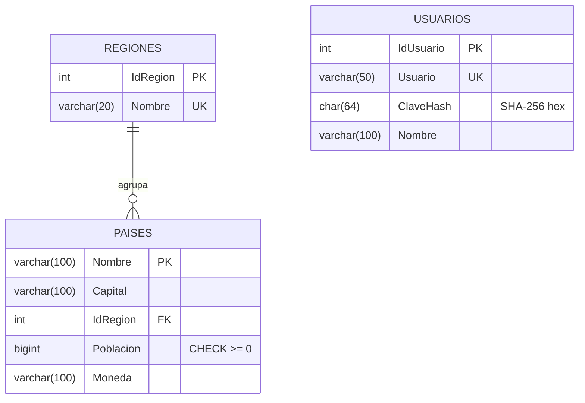

# Modelo entidad-relación: APIPaisesDB

Especificación para dibujar el MER (CDM/LDM/PDM) en PowerDesigner. Coincide con `03. BDD/APIPaisesDB.sql`.

| Entidad | Atributo | Tipo | Restricciones | Origen del dato |
|---|---|---|---|---|
| Regiones | IdRegion | int | PK, autoincremental | — |
| | Nombre | varchar(20) | único, no nulo | Catálogo fijo: América, Europa, Asia, África, Oceanía, Antártida |
| Paises | Nombre | varchar(100) | PK | `names.translations.spa.common`, o `names.common` si no hay traducción |
| | Capital | varchar(100) | no nulo | Capital principal, o «Sin capital» |
| | IdRegion | int | FK → Regiones, no nulo | `region` traducida al español |
| | Poblacion | bigint | no nulo, ≥ 0 | `population` |
| | Moneda | varchar(100) | no nulo | Primera moneda como «nombre (código)», o «Sin moneda» |
| Usuarios | IdUsuario | int | PK, autoincremental | — |
| | Usuario | varchar(50) | único, no nulo | Cargado por `init.sql` |
| | ClaveHash | char(64) | no nulo | SHA-256 de la clave |
| | Nombre | varchar(100) | no nulo | Nombre visible en los clientes |

Relaciones:
- **Regiones 1 — 0..N Paises** (`FK_PAISES_REGIONES`, `ON DELETE RESTRICT`): no se puede borrar una región que tenga países.
- **Usuarios** es independiente: solo sirve para autenticar (ECUD1).
